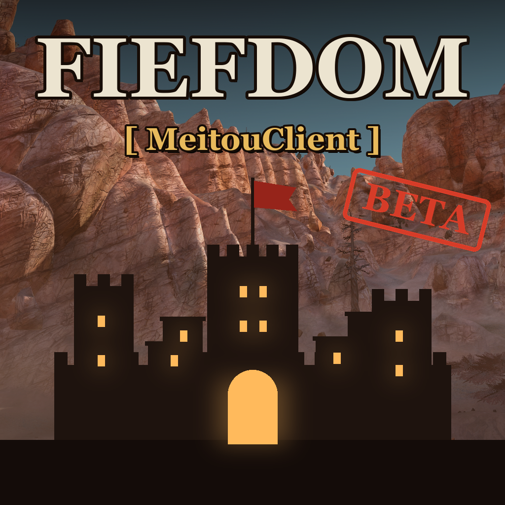

# Fiefdom

A code mod for [MeitouClient](https://meitou.kenshi.wiki) that turns one of your outposts into a living town. Settlers arrive and ask to live there, residents work its machines and shop counters for wages, guards patrol and patch up the wounded, and visitors come to shop. The original Kenshi ignores it.

> **This is a beta build, and it will be broken in places.** Fiefdom is going to be built on and changed heavily: features will be added, reworked or pulled out, and numbers will move. Expect an imperfect experience, back up any save you care about, and expect a later version to change how your town works. It also runs on MeitouClient's newest nightlies, which can stop it loading until an update comes out. Bug reports are very much wanted: please post them on the [MeitouClient Discord](https://discord.gg/DVAHH2n9DR) or as an [issue here on GitHub](https://github.com/teppuM/meitou-fiefdom/issues), with what happened, your MeitouClient version and your `log.txt` (and a save if you can share one).

## What it does

### Making a town

- Hover over one of your outposts and its panel (bottom right) gets a **Fiefdom** line. Press **Make a town**, then **Town window** to run it.
- A building's job comes from its furniture, not a label. Every machine people work, every gun turret and every shop counter is a work post. Furniture other mods add counts the same way.
- A house gets two buttons on its own panel:
  - **Lives here** cycles between Residents, Guards and Nobody. One person lives there per bed.
  - **Boxes inside** switches between All town stock and As marked.
- Each storage box can be marked **Keep for me** or **Town stock**. Your townspeople and guards eat from town stock, fetch their machines' goods from it and put what they make in it; a box kept for you they never touch. Your own squads use every box as before. A town with townspeople and no town stock says so in its news.

### Settlers and the steward

- While the town is open and has a free bed, a group of settlers comes every few days. They are drawn from the wandering groups of the town's region, so groups other mods add to a region can settle too.
- How often groups come depends on the town's **pull**. Shops with goods and your own people in town raise it. Residents killed or leaving hungry lower it.
- You choose which races are welcome, a town cap, and the pace, and whether to let in people the region's weather (acid rain, fire, gas) would hurt.
- When a group arrives you can **Accept** or **Refuse** them yourself, or right-click one of your characters in town and choose **Make town steward** to let them decide.
- Every steward keeps the hard rules: free beds and the cap. Within those, their own personality colors the call:
  - Kind stewards take in the poor.
  - Cruel stewards turn them away.
  - Smart stewards want new skills.
  - Fearful stewards refuse armed groups.
  - Traitorous stewards take bribes.
  - Dumb or maniacal stewards sometimes just get it wrong.
- Residents get their own squads. They aren't led by you and don't count toward your squad limit. They live in the house, sleep in its beds and keep a purse of their own.
- Right-click a resident to **Evict** them.

### Work, wages and shops

- The **Work** tab lists every kind of work in town, building by building. Give a line its hours: Day and night, Day only, Night only, or Two shifts. Then put residents on it with plus and minus.
- Workers get the game's own job for their post while on shift, and step away to eat when hungry.
- A worker tends their own machine first, then any other machine of the same kind in town that needs work (any field for a farmer), so nobody stands idle while a machine waits.
- Other mods' jobs show up too: a job another mod lets you give from a building's right-click menu gets its own line on that building, and your residents work it like any other post.
- Fiefdom only ever takes away the jobs it gave, so a job another mod gives one of your townspeople stays.
- Wages are paid at each day change, per shift worked, from your money into the worker's home purse. Unpaid workers stop, and leave after three unpaid days.
- Residents without a post earn a small outside income instead.
- A resident on a **shop counter** becomes its merchant. They carry goods from town-stock boxes to the counter, never the town's last meals, and the game's own shoppers and the town's visitors buy from it. The takings are yours, less the merchant's share (25% to start), which goes into the merchant's household purse. A merchant takes no wage: the share is all they earn, so a counter you stock yourself with nobody on it keeps every cat for you. You choose what kinds of goods each counter sells.

### Guards

- Set a house's **Lives here** to Guards and it becomes a guardhouse. Its guards are one squad that, like your residents, you cannot select or command. They do their duty on their own:
  - **Patrol** walks the whole town by day.
  - **Gates** mans the gates you built in the town.
- Guards fight anyone hostile without leaving town.
- Guards carrying a first aid kit bandage anyone of yours in town who needs it, themselves included, and get out of bed to do it. A guard without a kit fetches one from town stock, and merchants leave two kits per guard there.
- Guards earn a daily wage, and leave after three unpaid days.

### Town life

- Residents wander the town by day and sit about in its public buildings in the evening, so a public building with chairs becomes the town's bar.
- Residents and guards sleep when tired or wounded, which is the game's own rule for your faction.
- **Food runners** carry meals from town stock to any resident or guard who is getting hungry and has no food on them, the most filling food first.
- Residents greet your characters as they pass, and grumble when their wages are late or they're hungry.
- The **Residents** tab keeps the town's news: who came, who was turned away, who died, who took a post.

### Visitors and policies

- While the town is open to the public, a group of visitors comes about once a day. They walk to your shop, buy something each, pay you, and move on after a few hours.
- The **Policies** tab lists every race seen in or near the town in the last week. Set any of them to **Attack on sight** and your guards will go after them. The game's usual relation costs apply.

### Settings

On the Settings screen's Mods page:

| Setting | Default | Range |
|---|---|---|
| Residents' outside income, cats a day | 35 | 0 to 200 |
| Wage per shift worked, cats | 30 | 0 to 200 |
| Guard's wage, cats a day | 100 | 0 to 400 |
| Hours between visitor groups (0 for no visitors) | 24 | 0 to 96 |
| Days starving before a resident leaves | 1 | 0.25 to 5 |
| Food kept back for meals, per resident | 2 | 0 to 20 |
| Merchant's share of the takings, percent | 25 | 0 to 100 |

## Getting started

1. Build a house with beds at one of your outposts, and a storage box.
2. Press **Make a town** on the outpost's Fiefdom line.
3. Set the house's **Lives here** to Residents.
4. Mark the box **Town stock** and put some food in it.
5. Open the town to settlers on the **Settlers** tab, and wait for your first group.

## Install

1. Download the zip from the [Releases](https://github.com/teppuM/meitou-fiefdom/releases) page and unzip it into Kenshi's `mods` folder, so that you have `Kenshi\mods\Fiefdom\Fiefdom.dll`, `Fiefdom.mod` and `meitou.json`.
2. Turn it on in the MeitouClient launcher's mod list.

Or subscribe on the [Steam Workshop](https://steamcommunity.com/sharedfiles/filedetails/?id=3843652260) and turn it on the same way.

It needs MeitouClient 0.22.2 from the second nightly of 2026-11-22 on. Older builds lack what the mod is built on and refuse to load it.

## Known limits

- Guards only bandage people while they have first aid kits. A town without guards or kits leaves wounds untreated, and untreated wounds get worse whenever their owner is out of bed.
- Each guardhouse's squad counts against the game's limit of 10 squads you lead.
- Visitors buy through the mod rather than through the game's shopping, so they don't sit in your bar.
- Guards attack an outsider on sight until they fall, but don't finish off a downed one.

## Feedback and suggestions

- **Bugs and feedback:** please report them on the [MeitouClient Discord](https://discord.gg/DVAHH2n9DR) in the [Fiefdom thread](https://discord.com/channels/1560771083626487908/1573758617037832253/1573758617037832253) or as a [GitHub issue](https://github.com/teppuM/meitou-fiefdom/issues).
- **Suggestions** are welcome, but not guaranteed to be accepted. Everyone has the right to make their own version with blackjack and hookers if they want instead.
- **DMs are welcome.** Don't be afraid to [message me on Discord](https://discord.com/users/134194201385500672) at any time about it.

## Building

- `src/Fiefdom.csproj` builds the code with the .NET 11 SDK against an official MeitouClient release folder: `dotnet build -c Release -p:MeitouBin=<release folder>/`. A self-built MeitouClient won't do: its files carry a different version number, and a mod built against them won't load in the official releases.
- `tools/fmod` writes `Fiefdom.mod`, the mod's own game records (the townspeople's packages and their town-wander goal), with the engine's own mod file writer. Run it after changing a record. Never renumber a record's id.
- `tools/fdata` reads the merged game data (AI packages, squad templates, regions) from the command line, for working out what the game's records hold.
- The mod adds a few testing rows to the F10 debug menu's Mods category:
  - bring settlers or visitors now
  - plan beds or a shop counter
  - stock the town with food or first aid kits
  - log what every townsperson is doing

## License

Public domain, under the [Unlicense](LICENSE). Fork it, change it, ship it, sell it: do whatever you want with it, no credit needed. MeitouClient itself is GPL 3.0 or later; this covers Fiefdom's own code and data.
